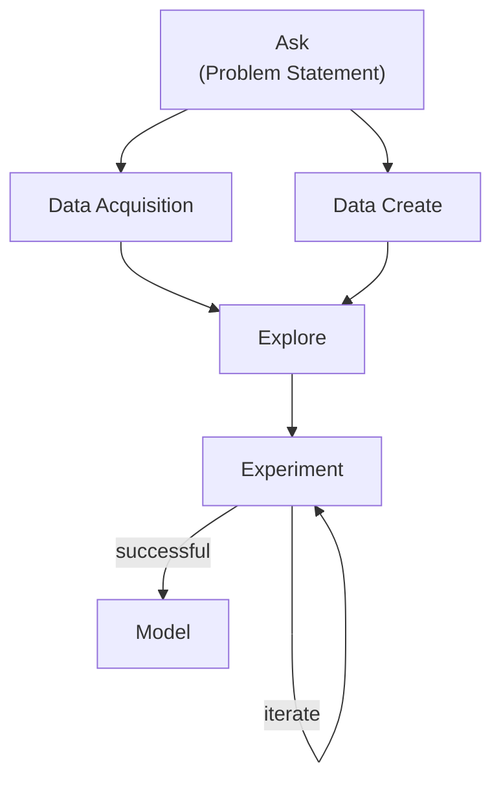

# MermaidSeg

Codebase for the training, evaluation and usage of image segmentation models of coral data.
The codebase contains data loaders, augmentations, preprocessors, models, training & evaluation scripts.

## Usage

### Installation

Prerequisites
- Python 3.11+
- AWS credentials configured with `mermaid-core` profile (for S3 access)
- Hugging Face account and token (for DINOv3 models; see [Hugging Face Setup](#hugging-face-setup) below)
- uv (recommended) or pip

**Quick setup with uv** (recommended):
```bash
git clone https://github.com/your-org/mermaid-segmentation.git
cd mermaid-segmentation

# Install uv if needed
curl -LsSf https://astral.sh/uv/install.sh | sh

# Configure AWS access
aws configure --profile mermaid-core
echo "AWS_PROFILE=mermaid-core" >> .env

# Configure Hugging Face (required for DINOv3 models)
hf auth login
# Or add your token to .env: echo "HF_TOKEN=hf_xxxxxxxxxxxx" >> .env

# Install core dependencies
uv sync
```

**Install the contributor dependency group** as needed:
```bash
uv sync --group dev         # tests + lint (contributor setup)
```


### Hugging Face Setup

DINOv3 models (e.g. `facebook/dinov3-vitb16-pretrain-lvd1689m`) are gated on Hugging Face and require authentication:

1. **Request access**: Visit the [model page](https://huggingface.co/facebook/dinov3-vitb16-pretrain-lvd1689m), sign in, and accept the license to request access.
2. **Authenticate** using one of these methods:
   - **CLI login** (recommended): Run `hf auth login` and paste your token when prompted.
   - **Environment variable**: Add `HF_TOKEN=hf_xxxxxxxxxxxx` to your `.env` file (create from `.env.example`). Create a token at [hf.co/settings/tokens](https://hf.co/settings/tokens).

If using `.env` with direnv, ensure you run `direnv allow` and restart your shell so it picks up the token.

### Segmentation Models
Train a concept-bottleneck model from the repository root:

```bash
uv run python scripts/train.py --num-workers 4 --cache-dir /path/to/cache
```

`--num-workers` is required. The config flags `--training-config`, `--model-config`,
`--data-config`, `--concept-schema-config` and `--logger-config` take repo-relative paths under
`configs/`. `--resolution` sets the train crop size and the model input size; val and test images
resize to the model input size. Checkpoints go to
`outputs/model_checkpoints/<run>/`; `--output-dir` changes `outputs`. Each run also writes its resolved config to `outputs/model_checkpoints/<run>/config.yaml`, as a record of the settings the run used. It is not meant to be passed back in as a run config.
At the start, each run also writes `outputs/model_checkpoints/<run>/model.json`: the architecture, encoder config, label and concept maps, preprocessing and lineage (git SHA, dirty flag, `uv.lock` hash, seed, data version and resolved config).

`slurm/launch_final.sh` submits the final model: training on train + val, then its 768 px
fine-tune. It submits through `slurm/train.sbatch`, with site settings from `.env` (see `.env.example`).
It is idempotent and accepts `--dry-run`.
Batch jobs write `.venv`, `outputs/` and `logs/` inside the checkout, so it must be on a filesystem the job can write, not AFS, because batch jobs have no AFS token. Set `MERMAIDSEG_ENV_FILE` to read the settings from an env file elsewhere.

### Train on SageMaker (backup)

SageMaker runs the same `scripts/train.py` with the same arguments as `slurm/launch_final.sh`. Use it when Slurm is not available. Jobs are on-demand and do not resume: relaunch a failed job from scratch.

1. Set the SageMaker variables in `.env` (see `.env.example`) and load it: the Makefile reads them from the environment.
2. Run the `sagemaker-image` GitHub workflow (Actions, Run workflow). Only `main` can run it. It builds the image, pushes `training-<sha>` and moves `training-latest`; see [docker/jobs/README.md](docker/jobs/README.md). The job runs the code and `configs/` baked into the image: `training-latest` is `main` at the last workflow run. Only the run YAML travels with the job. Merge config and code changes, and rerun the workflow, before you launch.
3. Run `make sm-validate` to check the run YAML offline. It checks only your local checkout, not the image. The 768 px YAML sets `train.init_weights`, so it also needs `INIT_FROM_JOB`: `make sm-validate SM_RUN_CONFIG=sagemaker/runs/cbm_final_res768.yaml INIT_FROM_JOB=<cbm_final job name>`.
4. Run `make sm-launch` to submit `cbm_final` (`sagemaker/runs/cbm_final.yaml`). `make sm-dry-run` shows the request without submitting.
5. When `cbm_final` finishes, submit the 768 px fine-tune with the first job's name:
   `make sm-launch SM_RUN_CONFIG=sagemaker/runs/cbm_final_res768.yaml INIT_FROM_JOB=<cbm_final job name>`
   The launcher first requires the source job to be `Completed` and its init checkpoint to be readable in S3, and refuses to launch otherwise.

At launch, the launcher resolves `job.image` (`repo:tag`) to its ECR digest, submits `repo@sha256:...` and prints it. A job keeps running that exact image even if `training-latest` later moves. A `job.image` already in digest form is used as is. `--check` and `--dry-run` make no AWS call; a dry run shows the tag.

Checkpoints sync to `s3://$SM_STAGING_BUCKET/runs/<job>/checkpoints/model_checkpoints/<run>/` (`model_step*`, `model.json`, `config.yaml`). Download them from there for export. The `git_sha` in `model.json` and the saved `config.yaml` record what the job ran.

Monitor a job with `make sm-jobs`, `sm-status`, `sm-logs`, `sm-errors` and `sm-metrics`. These targets need the AWS CLI. All but `sm-jobs` need `JOB=<training-job-name>`, from `make sm-jobs` or the launcher's output. The first lines of the job log show the disk space for `/opt/ml/cache` and `/opt/ml/checkpoints`; on the first run, check where the cache lands.

Both run YAMLs set `max_runtime_hours` above the 5-day default of the account Service Quota "Longest run time for a training job": 480 h for `cbm_final` and 168 h for `cbm_final_res768`. Raise the quota to at least 480 h first.

### Export a model

Export a finished run as a bundle, then evaluate the bundle:

```bash
uv run python scripts/train.py --num-workers 4 --cache-dir /path/to/cache
uv run python scripts/export.py --checkpoint outputs/model_checkpoints/<run>/<checkpoint> --output-dir /path/to/bundle
uv run python scripts/evaluate.py --bundle /path/to/bundle --output-dir /path/to/results
```

The bundle holds `model.json` and `weights.safetensors`. These two files are the contract with `mermaid-inference`.
`scripts/export.py` refuses a run from a dirty or unknown git tree, a non-empty output directory, a missing parent directory, and a checkpoint whose config differs from the run's `model.json`.

`scripts/evaluate.py` is the validation suite (CoralNet, Pacific Labeled Corals, CoralscapesV2
few-shot probes and the validation loss). It evaluates an exported bundle: input size, normalization, label maps and run settings come from the bundle.

### Running Tests

```bash
uv sync --group tests
```

**Run all tests:**
```bash
uv run pytest
```

**Run only unit tests (skip integration tests):**
```bash
uv run pytest -m "not integration"
```

**Run specific test file:**
```bash
uv run pytest tests/test_logger.py -v
```


## Model Serialization Strategy

Training checkpoints use `torch.save` (pickle): the full state (model + optimizer + scheduler) is needed to resume. Load only checkpoints you trust, because pickle can execute code on load.

### Concept Bottleneck Models

Non-taxonomic concept metrics in `mermaidseg/model/eval.py` are multiclass `Accuracy` with a hard-coded `num_classes=3` and `ignore_index=0`: class 0 is excluded from the metric, and the other two classes are the concept's two states. Taxonomic concepts use `Accuracy` with a per-concept class count derived from `concept_value2id`.

## DSLP Issue Workflow

This project follows the [Data Science Lifecycle Process (DSLP)](https://github.com/dslp/dslp) for managing data science work. We use structured issue templates to track different stages of the workflow.



### Issue Types

When creating a new issue, select the appropriate template:

- **Ask**: Define the problem statement and proposed solution. This is the starting point for any data science initiative.
- **Data Acquisition**: Request access to or retrieval of an existing dataset needed for the project.
- **Data Create**: Document the creation of a new derived dataset from existing sources.
- **Explore**: Capture data exploration efforts and discoveries that build understanding.
- **Experiment**: Track modeling experiments and approaches for solving the problem.
- **Model**: Productionalize a successful experiment and prepare it for deployment.
- **Bug Report**: Report bugs, errors, or unexpected behavior in the codebase.
