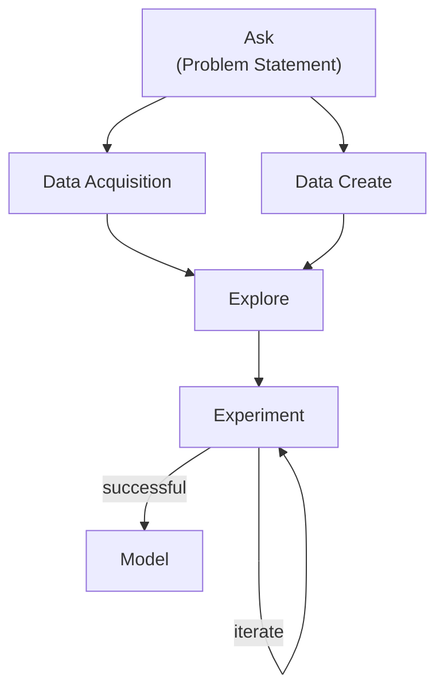

# MermaidSeg

Codebase for the training, evaluation and usage of image segmentation models of coral data.
The codebase contains data loaders, augmentations, preprocessors, models, training & evaluation scripts.

## Usage

### Installation

Prerequisites
- [uv](https://docs.astral.sh/uv/)
- Python 3.11 or later (`requires-python` in `pyproject.toml`). `.python-version` pins 3.12, which uv uses by default.
- AWS credentials configured with the `mermaid-core` profile, for S3 access
- A Hugging Face account and token, for DINOv3 models (see [Hugging Face Setup](#hugging-face-setup))

```bash
git clone https://github.com/data-mermaid/mermaid-segmentation.git
cd mermaid-segmentation

# Install uv if needed
curl -LsSf https://astral.sh/uv/install.sh | sh

# Configure AWS access
aws configure --profile mermaid-core
echo "AWS_PROFILE=mermaid-core" >> .env

# Configure Hugging Face (required for DINOv3 models)
hf auth login
# Or add your token to .env: echo "HF_TOKEN=hf_xxxxxxxxxxxx" >> .env

# Install the locked dependencies, with the tracker extra for your run (see below)
uv sync --locked --extra slurm
```

The core install has no experiment tracker. Add the extra for the backend your run logs to:

| Extra | Installs | Use |
|---|---|---|
| `slurm` | wandb | Local and Slurm runs (the default logger config) |
| `sagemaker` | mlflow, sagemaker-mlflow | SageMaker runs; the training image installs it |

A run whose tracker is not installed stops at start with an `ImportError` that names the extra. See [Experiment tracking](#experiment-tracking).

Contributors add a dependency group:

| Group | Contents |
|---|---|
| `tests` | pytest and pytest-cov |
| `lint` | ruff, pre-commit and mypy |
| `dev` | `tests` and `lint` |

```bash
uv sync --locked --extra slurm --group dev
```

### Hugging Face Setup

DINOv3 models (for example `facebook/dinov3-vitb16-pretrain-lvd1689m`) are gated on Hugging Face and need authentication:

1. **Request access**: Open the [model page](https://huggingface.co/facebook/dinov3-vitb16-pretrain-lvd1689m), sign in, and accept the license.
2. **Authenticate** with one of these methods:
   - **CLI login** (recommended): Run `hf auth login` and paste your token when prompted.
   - **Environment variable**: Add `HF_TOKEN=hf_xxxxxxxxxxxx` to your `.env` file (create it from `.env.example`). Create a token at [hf.co/settings/tokens](https://hf.co/settings/tokens).

If you use `.env` with direnv, run `direnv allow` and restart your shell so it picks up the token.

### Architecture overview

```text
scripts/train.py
  -> mermaidseg/training.py
       configs validated by mermaidseg/config.py (strict pydantic models)
       labels and concepts from mermaidseg/dataset_reconciliation/
       MetaModel (mermaidseg/model/meta.py), Logger over a wandb or MLflow tracker (mermaidseg/logger.py)
  -> outputs/model_checkpoints/<run>/
       model_step* checkpoints (with lineage), config.yaml, model.json
  -> scripts/export.py (mermaidseg/export.py)
  -> bundle: weights.safetensors + model.json
  -> mermaidseg/inference/ (load_bundle, preprocess, CBMPredictor)
       used by scripts/evaluate.py and by the mermaid-inference service
```

`scripts/train.py` is the only training entrypoint. Each compute substrate has a thin launcher that runs it with the same config: your shell (local), `slurm/launch_final.sh` (Slurm) and `scripts/sagemaker/` (SageMaker). `AGENTS.md` section 1 has the directory map.

### Segmentation Models

#### Local

Train a concept-bottleneck model from the repository root:

```bash
uv run python scripts/train.py --num-workers 4 --cache-dir /path/to/cache
```

`--num-workers` is required. The flags `--training-config`, `--model-config`, `--data-config`, `--concept-schema-config` and `--logger-config` take repo-relative paths under `configs/`. `--resolution` sets the train crop size and the model input size. Val and test images resize to the model input size.

Checkpoints go to `outputs/model_checkpoints/<run>/`. `--output-dir` changes `outputs`. Each run writes two files there:

- `config.yaml`: the resolved config, as a record of the settings the run used. Do not pass it back in as a run config.
- `model.json`, written when the run starts: the architecture, encoder config, label and concept maps, preprocessing and lineage (git SHA, dirty flag, `uv.lock` hash, seed, data version and resolved config).

#### Experiment tracking

`mermaidseg/logger.py` logs through one interface with two backends. The `tracker` key of the logger config (`wandb` or `mlflow`) picks the backend; any other name raises `ValueError`.

| Backend | Logger config | Extra | Environment |
|---|---|---|---|
| wandb | `configs/logger_config.yaml` (the `--logger-config` default; Slurm and local) | `slurm` | `WANDB_API_KEY`, or a prior `wandb login`; checked when the tracker starts |
| MLflow | `configs/logger_config_sagemaker.yaml` (passed by the SageMaker run YAMLs) | `sagemaker` | `MLFLOW_TRACKING_URI`; the run raises if it is unset. The SageMaker launcher sets it from `SM_MLFLOW_TRACKING_ARN` |

A run that crashes is recorded as `FAILED` in MLflow and with `exit_code` 1 in wandb.

#### Slurm

`slurm/launch_final.sh` submits the final model: training on train + val, then its 768 px fine-tune. It submits through `slurm/train.sbatch`, with site settings from `.env` (see `.env.example`). It is idempotent and accepts `--dry-run`.

Batch jobs write `.venv`, `outputs/` and `logs/` inside the checkout. The checkout must be on a filesystem the job can write to. AFS does not work, because batch jobs have no AFS token. To read the settings from an env file elsewhere, set `MERMAIDSEG_ENV_FILE`.

#### SageMaker

SageMaker is the backup to Slurm. It runs the same `scripts/train.py` with the same arguments as `slurm/launch_final.sh`. Jobs are on-demand and do not resume: relaunch a failed job from scratch.

1. Set the SageMaker variables in `.env` (see `.env.example`) and load it: the Makefile reads them from the environment. `SM_MLFLOW_TRACKING_ARN` is the ARN of the MLflow tracking server the job logs to.
2. Run the `sagemaker-image` GitHub workflow (Actions, Run workflow). Only `main` can run it. It builds the image, pushes `training-<sha>` and moves `training-latest`; see [docker/jobs/README.md](docker/jobs/README.md). The job runs the code and `configs/` baked into the image: `training-latest` is `main` at the last workflow run. Only the run YAML travels with the job. Merge config and code changes, and rerun the workflow, before you launch.
3. Run `make sm-validate` to check the run YAML offline. It checks only your local checkout, not the image. The 768 px YAML sets `train.init_weights`, so it also needs `INIT_FROM_JOB`: `make sm-validate SM_RUN_CONFIG=sagemaker/runs/cbm_final_res768.yaml INIT_FROM_JOB=<cbm_final job name>`.
4. Run `make sm-launch` to submit `cbm_final` (`sagemaker/runs/cbm_final.yaml`). `make sm-dry-run` shows the request without submitting.
5. When `cbm_final` finishes, submit the 768 px fine-tune with the first job's name:
   `make sm-launch SM_RUN_CONFIG=sagemaker/runs/cbm_final_res768.yaml INIT_FROM_JOB=<cbm_final job name>`
   The launcher first requires the source job to be `Completed` and its init checkpoint to be readable in S3, and refuses to launch otherwise.

At launch, the launcher resolves `job.image` (`repo:tag`) to its ECR digest, submits `repo@sha256:...` and prints it. A job keeps running that exact image even if `training-latest` later moves. A `job.image` already in digest form is used as is. `--check` and `--dry-run` make no AWS call; a dry run shows the tag.

Checkpoints sync to `s3://$SM_STAGING_BUCKET/runs/<job>/checkpoints/model_checkpoints/<run>/` (`model_step*`, `model.json`, `config.yaml`). Download them from there for export. The `git_sha` in `model.json` and the saved `config.yaml` record what the job ran.

Monitor a job with `make sm-jobs`, `sm-status`, `sm-logs`, `sm-errors` and `sm-metrics`. These targets need the AWS CLI. All except `sm-jobs` need `JOB=<training-job-name>`, from `make sm-jobs` or the launcher's output. The first lines of the job log show the disk space for `/opt/ml/cache` and `/opt/ml/checkpoints`. On the first run, check where the cache lands.

Both run YAMLs set `max_runtime_hours` above the 5-day default of the account Service Quota "Longest run time for a training job": 480 h for `cbm_final` and 168 h for `cbm_final_res768`. Raise the quota to at least 480 h first.

### Export a model

Export a finished run as a bundle, then evaluate the bundle:

```bash
uv run python scripts/export.py --checkpoint outputs/model_checkpoints/<run>/<checkpoint> --output-dir /path/to/bundle
uv run python scripts/evaluate.py --bundle /path/to/bundle --output-dir /path/to/results
```

The bundle holds `model.json` and `weights.safetensors`. These two file names are the contract with `mermaid-inference`.

`scripts/export.py` refuses:
- a checkpoint with no recorded lineage
- a checkpoint whose lineage records a dirty or unknown git tree (each checkpoint records the lineage of the session that wrote it)
- a checkpoint whose config differs from its recorded lineage
- a non-empty output directory
- a missing parent directory

Export needs a run trained with this version or later. Older runs have no `model.json`, and their checkpoints record no lineage.

`scripts/evaluate.py` is the validation suite: CoralNet, Pacific Labeled Corals, CoralscapesV2 few-shot probes and the validation loss. It evaluates an exported bundle. Input size, normalization, label maps and run settings come from the bundle. The model comes only from `--bundle`; the old `--checkpoint`, `--model-config`, `--training-config`, `--resolution`, `--id2label`, `--concept-id2name` and `--taxonomy-csv` flags are gone.

### Running Tests

```bash
uv sync --locked --group tests --extra slurm --extra sagemaker
```

CI installs both tracker extras; without the `sagemaker` extra the MLflow tracker tests skip. It runs this selection (`.github/workflows/tests.yml`). Use it before you open a PR:

```bash
uv run --group tests --extra slurm --extra sagemaker pytest -m "not slow and not integration and not live"
```

`pyproject.toml` defines these markers:

| Marker | Meaning |
|---|---|
| `live` | Needs S3 or CoralNet access. Deselected by default through `addopts`. |
| `slow` | Slow tests. |
| `integration` | Integration tests. |
| `smoke` | Fast offline smoke tests of the training pipeline wiring. |

Tests that need a GPU skip when none is available.

A test for `<path>/<name>.py` lives at `tests/<path>/test_<name>.py`. For example, the tests for `mermaidseg/logger.py` are in `tests/mermaidseg/test_logger.py`:

```bash
uv run pytest tests/mermaidseg/test_logger.py -v
```

To run the `live` tests, select them with `-m live`.

### Common Commands

```bash
uv lock --check                        # lockfile matches pyproject.toml
uv run --group lint ruff check         # lint
uv run --group lint ruff format --check
uv run --group lint mypy               # type check
uv run --group lint pre-commit run --all-files
bash slurm/launch_final.sh --dry-run   # print the sbatch commands; needs the Slurm variables in .env
```

CI runs the first four commands (`.github/workflows/lint.yml`).

Warm the local S3 cache before an offline run. This is the only step that needs AWS credentials. `--cache-dir` has no default and the script has nowhere to write without it:

```bash
uv run python scripts/prefetch_cache.py --cache-dir /path/to/cache
```

`--data-config` and `--training-config` default to `configs/data_config.yaml` and `configs/training_config_cbm_final.yaml`. Run the script with `--help` for the other options.

SageMaker `make` targets (see [SageMaker](#sagemaker)):

| Target | What it does |
|---|---|
| `make sm-validate` | Checks the run YAML offline. |
| `make sm-dry-run` | Shows the job request without submitting. |
| `make sm-launch` | Submits the job. |
| `make sm-smoke` | Runs `docker/jobs/local_smoke.sh`. |
| `make sm-jobs` | Lists the 10 most recent training jobs. |
| `make sm-status` | Shows one job's status and failure reason. |
| `make sm-logs` | Follows one job's logs. |
| `make sm-errors` | Shows error lines from one job's logs. |
| `make sm-metrics` | Shows peak disk, RAM, GPU memory and CPU of one job. |

## Model Serialization Strategy

The project uses two formats.

**Checkpoints.** Training and resume checkpoints are `torch.save` pickles. They hold the full state (model, optimizer and scheduler) that a resume needs. The code loads them with `weights_only=True` (`read_checkpoint` in `mermaidseg/run_setup.py`). `AGENTS.md` 9.6 allows `weights_only=False` only for a resume checkpoint that this project's own training wrote, with a comment at the call site. No call site uses it. Load every other checkpoint with `weights_only=True`.

**Bundle.** The deployable bundle is SafeTensors plus `model.json` (`export_bundle` in `mermaidseg/export.py`, `load_bundle` in `mermaidseg/inference/bundle.py`). `model.json` carries the architecture, label and concept maps, preprocessing and lineage, so a bundle describes itself. The names `weights.safetensors` and `model.json` are a contract with `mermaid-inference`. Do not change them without coordinating with that project.

### Concept Bottleneck Models

Non-taxonomic concept metrics in `mermaidseg/model/eval.py` are multiclass `Accuracy` with a hard-coded `num_classes=3` and `ignore_index=0`: class 0 is excluded from the metric, and the other two classes are the concept's two states. Taxonomic concepts use `Accuracy` with a per-concept class count derived from `concept_value2id`.

## DSLP Issue Workflow

This project follows the [Data Science Lifecycle Process (DSLP)](https://github.com/dslp/dslp) for managing data science work. We use structured issue templates to track different stages of the workflow.



### Issue Types

When creating a new issue, select the appropriate template:

- **Ask**: Define the problem statement and proposed solution. This is the starting point for any data science initiative.
- **Data Acquisition**: Request access to or retrieval of an existing dataset needed for the project.
- **Data Create**: Document the creation of a new derived dataset from existing sources.
- **Explore**: Capture data exploration efforts and discoveries that build understanding.
- **Experiment**: Track modeling experiments and approaches for solving the problem.
- **Model**: Productionalize a successful experiment and prepare it for deployment.
- **Bug Report**: Report bugs, errors, or unexpected behavior in the codebase.
