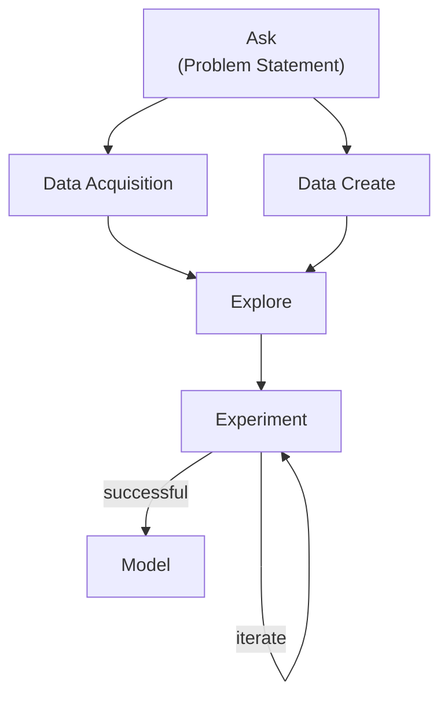

# MermaidSeg

Codebase for the training, evaluation and usage of image segmentation models of coral data.
The codebase contains data loaders, augmentations, preprocessors, models, training & evaluation scripts.

## Usage

### Installation

Prerequisites
- Python 3.11+
- AWS credentials configured with `mermaid-core` profile (for S3 access)
- Hugging Face account and token (for DINOv3 models; see [Hugging Face Setup](#hugging-face-setup) below)
- uv (recommended) or pip

**Quick setup with uv** (recommended):
```bash
git clone https://github.com/your-org/mermaid-segmentation.git
cd mermaid-segmentation

# Install uv if needed
curl -LsSf https://astral.sh/uv/install.sh | sh

# Configure AWS access
aws configure --profile mermaid-core
echo "AWS_PROFILE=mermaid-core" >> .env

# Configure Hugging Face (required for DINOv3 models)
hf auth login
# Or add your token to .env: echo "HF_TOKEN=hf_xxxxxxxxxxxx" >> .env

# Install core dependencies
uv sync
```

**Install the contributor dependency group** as needed:
```bash
uv sync --group dev         # tests + lint (contributor setup)
```


### Hugging Face Setup

DINOv3 models (e.g. `facebook/dinov3-vitb16-pretrain-lvd1689m`) are gated on Hugging Face and require authentication:

1. **Request access**: Visit the [model page](https://huggingface.co/facebook/dinov3-vitb16-pretrain-lvd1689m), sign in, and accept the license to request access.
2. **Authenticate** using one of these methods:
   - **CLI login** (recommended): Run `hf auth login` and paste your token when prompted.
   - **Environment variable**: Add `HF_TOKEN=hf_xxxxxxxxxxxx` to your `.env` file (create from `.env.example`). Create a token at [hf.co/settings/tokens](https://hf.co/settings/tokens).

If using `.env` with direnv, ensure you run `direnv allow` and restart your shell so it picks up the token.

### Segmentation Models
Train a concept-bottleneck model from the repository root:

```bash
uv run python scripts/train.py --num-workers 4 --cache-dir /path/to/cache
```

`--num-workers` is required. The config flags `--training-config`, `--model-config`,
`--data-config`, `--concept-schema-config` and `--logger-config` take repo-relative paths under
`configs/`, and `--resolution` sets the image size. Checkpoints go to
`outputs/model_checkpoints/<run>/`; `--output-dir` changes `outputs`.

`slurm/launch_final.sh` submits the final model: training on train + val, then its 768 px
fine-tune. It submits through `slurm/train.sbatch`, with site settings from `.env` (see `.env.example`).
It is idempotent and accepts `--dry-run`.

`scripts/evaluate.py` is the validation suite (CoralNet, Pacific Labeled Corals, CoralscapesV2
few-shot probes and the validation loss).

### Running Tests

```bash
uv sync --group tests
```

**Run all tests:**
```bash
uv run pytest
```

**Run only unit tests (skip integration tests):**
```bash
uv run pytest -m "not integration"
```

**Run specific test file:**
```bash
uv run pytest tests/test_logger.py -v
```


## Model Serialization Strategy

Training checkpoints use `torch.save` (pickle): the full state (model + optimizer + scheduler) is needed to resume. Load only checkpoints you trust, because pickle can execute code on load.

### Concept Bottleneck Models

Non-taxonomic concept metrics in `mermaidseg/model/eval.py` are multiclass `Accuracy` with a hard-coded `num_classes=3` and `ignore_index=0`: class 0 is excluded from the metric, and the other two classes are the concept's two states. Taxonomic concepts use `Accuracy` with a per-concept class count derived from `concept_value2id`.

## DSLP Issue Workflow

This project follows the [Data Science Lifecycle Process (DSLP)](https://github.com/dslp/dslp) for managing data science work. We use structured issue templates to track different stages of the workflow.



### Issue Types

When creating a new issue, select the appropriate template:

- **Ask**: Define the problem statement and proposed solution. This is the starting point for any data science initiative.
- **Data Acquisition**: Request access to or retrieval of an existing dataset needed for the project.
- **Data Create**: Document the creation of a new derived dataset from existing sources.
- **Explore**: Capture data exploration efforts and discoveries that build understanding.
- **Experiment**: Track modeling experiments and approaches for solving the problem.
- **Model**: Productionalize a successful experiment and prepare it for deployment.
- **Bug Report**: Report bugs, errors, or unexpected behavior in the codebase.
